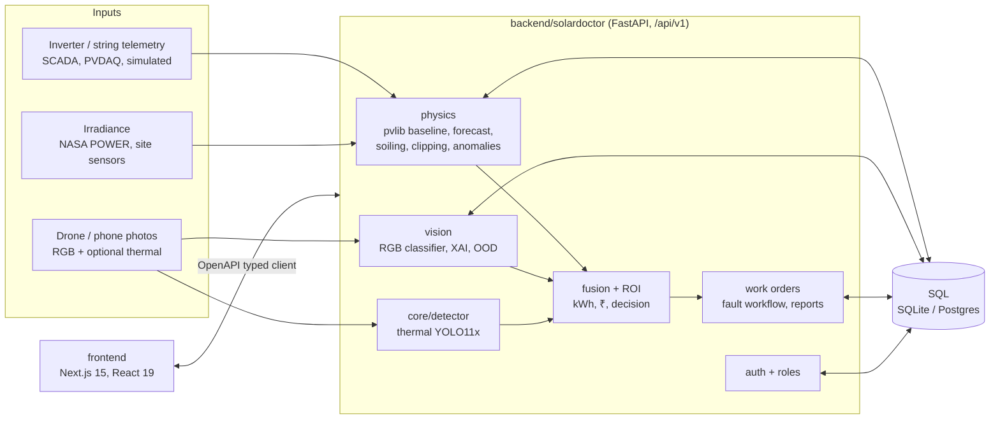

# SolarDoctor

[](https://github.com/madhavzanwar/solar-doctor/actions/workflows/ci.yml)


**AI solar O&M that closes the loop**: detect silent yield loss, diagnose the cause from a photo, explain it,
and turn it into rupees and a verified work order. Built by team **Photosphere** (PCCoE Pune).

| | Step | What it does |
|---|---|---|
| 01 | **Detect** | Compares inverter/string telemetry with a physics expected-power baseline (pvlib clear-sky + PVWatts) and flags sustained deficits on QC'd clear-sky periods. |
| 02 | **Diagnose** | 6-class RGB classifier (Clean, Dusty, Bird-drop, Snow-covered, Electrical-damage, Physical-damage); optional thermal YOLO11x module. |
| 03 | **Explain** | LIME superpixels + Grad-CAM, cross-checked against telemetry. |
| 04 | **Act** | Recoverable kWh and ₹, then *Clean now / Wait / Field check / Replace*, a work order, and verification by yield recovery. |

> Status: **v0.1 foundation**. Steps 01 and 04's plumbing are in progress; the RGB classifier, fusion and ROI engine
> arrive in the next milestone. Seeded demo data is labelled `SIMULATED`. No accuracy figure is claimed until measured.

## Architecture

Click a node to open its source.



```
backend/solardoctor/   API, DB, pipeline, park localisation, reporting (from AxalonSystems), physics (from SolarPulseAI)
ml/thermal/            thermal YOLO11x tooling      ml/forecast/   forecaster training
frontend/              dashboard (SolarPulseAI UI clone, rebranded)
legacy/axalon-nextjs/  old marketing/3D site, kept read-only until ported
drone/  alembic/  scripts/  deploy/  tests/  docs/solardoctor/
```

## Quick start

Python 3.11+, Node 20+.

```bash
git clone https://github.com/madhavzanwar/solar-doctor && cd solar-doctor
make setup        # venv, backend + frontend deps, .env from .env.example (first run is slow: ~9 min measured)
SOLARDOCTOR_SEED_ADMIN_PASSWORD='choose-a-long-password' make seed
                  # migrates the DB, then 3 demo plants + 30 days of SIMULATED telemetry and 2 users
make dev          # API http://localhost:8000/docs  +  UI http://localhost:3000   (Ctrl-C stops both)
make test         # backend pytest + frontend lint/tsc/vitest
make lint         # ruff + eslint
```

Log in at http://localhost:3000/login as `admin@solardoctor.example` with the password you set (without
`SOLARDOCTOR_SEED_ADMIN_PASSWORD` one is generated and printed once; `technician@solardoctor.example` works the same via
`SOLARDOCTOR_SEED_TECH_PASSWORD`). `.env` is created from `.env.example` and is loaded by `make seed`, `make dev`,
`make api`; it sets `SOLARDOCTOR_AUTH_MODE=users`. No network? `make seed SEED_ARGS=--offline`. Other ports:
`make dev API_PORT=8010 WEB_PORT=3010`.

### Troubleshooting

| Symptom | Cause / fix |
|---|---|
| `dev.sh: port 8000 is already in use` | Another process holds the port. Stop it or run `make dev API_PORT=8010 WEB_PORT=3010`. |
| API answers 401 / "Invalid email or password" for the seeded admin | The API is not in `users` mode (a `.env` without `SOLARDOCTOR_AUTH_MODE=users`; the app does not read `.env` itself, `make` sources it) or the password differs from the one used at seed time. Start the API with `make dev`/`make api`, not bare `uvicorn`, or export the variable. |
| `/api/v1/health` shows `"migrations": {"state": "failed"}`, log says `duplicate column name` | The DB was created by seeding an un-migrated database (older `make seed`). Delete `solardoctor.db` and run `make seed` again; it now runs `alembic upgrade head` first. |
| `make test` prints "WEIGHTS-DEPENDENT TESTS DESELECTED" | Expected until `ml/thermal/checkpoints/best.pt` exists (`make weights`; the Hugging Face repo is not published yet). 10 tests are deselected, all others must pass. |
| UI returns HTTP 500 and the dev log shows `next/font/google queries have exactly one entry` | The Next.js dev server could not download Google Fonts (needs network; seen once on a fresh clone behind a proxy). Check connectivity to `fonts.googleapis.com`, stop and re-run `make dev`. |
| Seed cannot reach NASA POWER | `make seed SEED_ARGS=--offline` uses the labelled synthetic cloud model instead. |

Thermal detection is off by default (`ENABLE_THERMAL=false`). Weights are **not** in git:

```bash
make weights      # downloads madhavzanwar/solar-doctor-thermal-yolo11x from Hugging Face
```

Set `ENABLE_THERMAL=true` afterwards. The weights are AGPL-3.0 (Ultralytics); see `THIRD_PARTY_NOTICES.md`.

## Docs

`docs/solardoctor/design/DESIGN.md` (design system) · `docs/solardoctor/research/landscape-report.md` ·
`docs/solardoctor/BASELINE_TESTS.md` · `docs/solardoctor/DECISIONS.md` · `docs/solardoctor/BUILD_LOG.md`

## Credits and licence

MIT. Built on [AxalonSystems](https://github.com/Parakh20/AxalonSystems) (MIT) and
[SolarPulseAI](https://github.com/anugrahpatil-creator/SolarPulseAI) (MIT). Full list: `THIRD_PARTY_NOTICES.md`.
